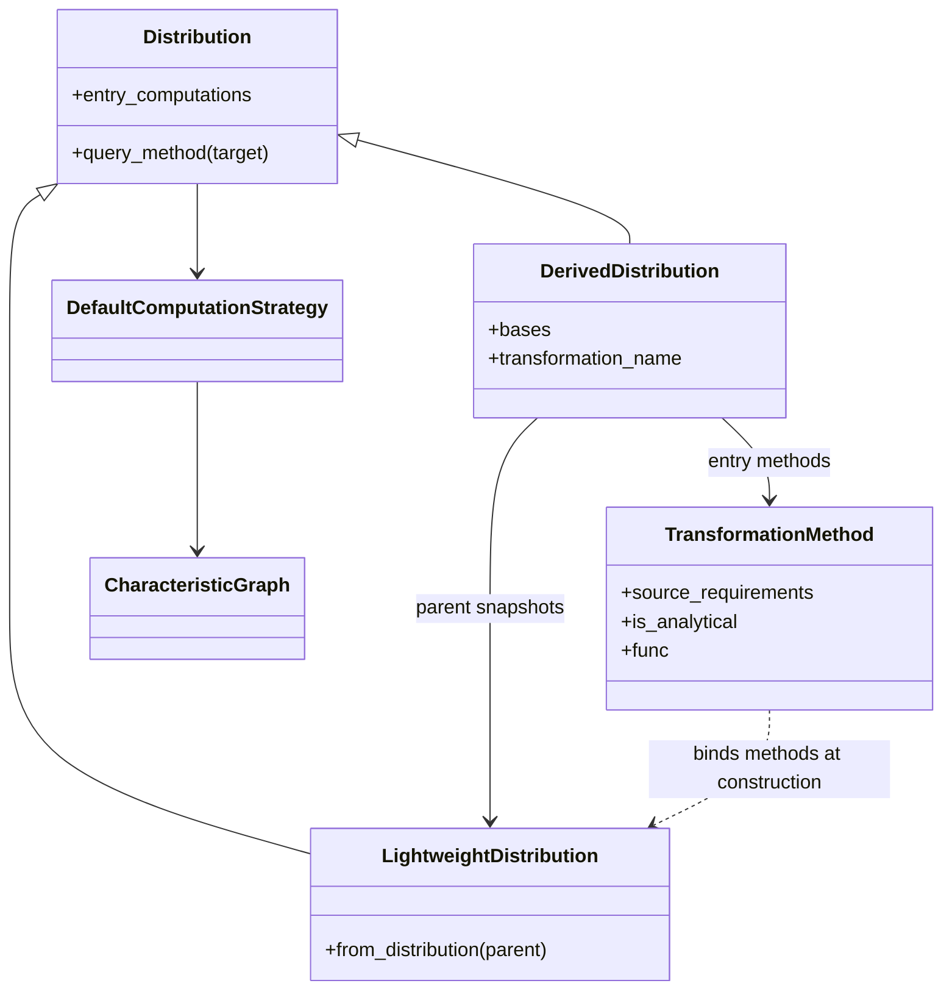
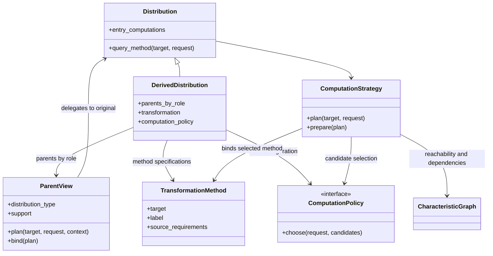
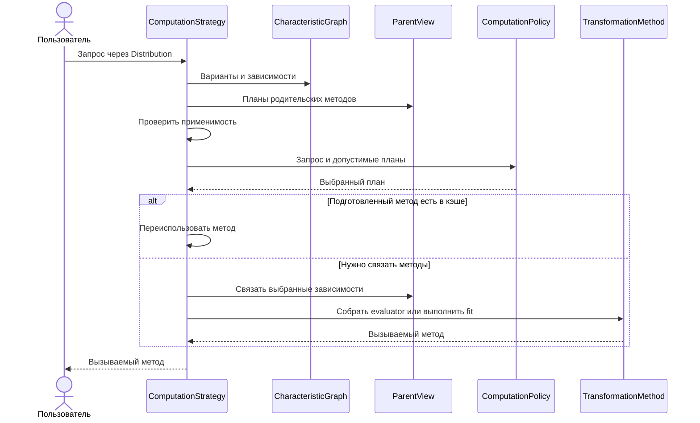

# ADR-0001. Входные вычисления и выбор плана преобразования

**Статус** — предложение для обсуждения командой.

Распределение объявляет, с каких вычислений можно начать. Преобразование объявляет, что ему нужно от родителей. Когда пользователь запрашивает характеристику, стратегия собирает возможные планы, а политика выбирает один с учётом применимости, точности и стоимости.

Документ предлагает расширить #147 от контракта входных методов до выбора плана преобразования. Опубликованный #147 описывает исходную миграцию API, а черновик PR #148 реализует переименование и пока сохраняет `is_analytical`. Ниже описано предложение для обсуждения в рамках эпика. [Задача #147](https://github.com/PySATL/pysatl-core/issues/147) · [Черновик PR #148](https://github.com/PySATL/pysatl-core/pull/148) · [Эпик #128](https://github.com/PySATL/pysatl-core/issues/128).

## 1. Почему текущей схемы недостаточно

Сейчас `DerivedDistribution` сохраняет снимки родителей (`LightweightDistribution`). При создании объекта `TransformationMethod` читает `source_requirements`, запрашивает у снимков нужные методы и передаёт готовые вызовы в фабрику вычисления. Например, метод плотности суммы уже связан с конкретными PDF родителей, когда пользователь ещё не запросил плотность и не задал ни область, ни допуск. [Устройство преобразований в эпике #128](https://github.com/PySATL/pysatl-core/issues/128).

Одновременно граф хранит `is_analytical`. Флаг сообщает об унаследованной классификации родительских методов. Например, плотность суммы может получить `True` от родителей и при этом считаться численной квадратурой. При выборе пути стратегия этот флаг не использует. Сохранение флага поддержало бы совместимость со старым фильтром. Классификация по способу вычисления могла бы описать алгоритм, но для выбора нужны конкретные сведения о зависимостях, применимости, качестве и стоимости. Предлагаем убрать флаг и объявлять эти свойства отдельно.

### Текущая схема на ветке PR #148

Имя карты уже изменено, а связывание при создании и снимки родителей ещё используются.

## 2. Зачем выбирать между планами. Плотность суммы

У независимых $X$ и $Y$ доступны соответственно CDF $F_X$ и плотность $f_Y$. Нужна плотность $Z=X+Y$. Один путь — взять численную производную от $F_X$, затем интегрировать произведение с $f_Y$. Другой — вычислить CDF суммы $F_Z(z)=\int F_X(z-y) f_Y(y)\,dy$ и взять её производную. Поскольку конечная разность $D_h$ линейна, при одной разностной формуле получаем

$$
D_h F_Z(z)=\int (D_h F_X)(z-y)\,f_Y(y)\,dy.
$$

На общих фиксированных узлах квадратуры это одна формула. Адаптивные схемы ведут себя по-разному. В первом случае квадратура должна разрешать резкие изменения численной производной родителя. Во втором независимые ошибки интегрирования могут усиливаться при делении на шаг $h$. При центральной разности ошибка до $\eta$ в каждом из двух значений CDF может дать вклад до $\eta/h$ в ошибку плотности. Число квадратур само по себе не определяет выгодный путь. [Текущие формулы PDF и CDF суммы](https://github.com/PySATL/pysatl-core/blob/cb0bfbca8d3b38e7a6929758f526a3c0d272cf3a/src/pysatl_core/transformations/operations/methods/binary/linear.py#L165) · [Разностная конверсия](https://github.com/PySATL/pysatl-core/blob/cb0bfbca8d3b38e7a6929758f526a3c0d272cf3a/src/pysatl_core/distributions/computations/continuous.py#L146).

Можно сразу вычислить плотность как $f_Z(z)=\int f_Y(z-x)\,dF_X(x)$. Например, при подготовке вычислить массы ячеек $w_i=F_X(b_i)-F_X(a_i)$, а затем переиспользовать их как веса в сумме $\sum_i w_i f_Y(z-x_i)$, где $x_i$ — середина ячейки. Одна подготовка даёт $m$ весов для $m$ ячеек, а запрос из $n$ точек требует $O(nm)$ значений $f_Y$. Если $f_Y$ липшицева с константой $L$, то при точной CDF вклад ячейки в ошибку ограничен $w_i L(b_i-a_i)/2$. Если отрезок сетки оставляет снаружи массу $\tau$, хвосты добавляют до $\tau\sup f_Y$. Эти оценки объясняют, почему форма плотности и масса хвостов важны для выбора сетки. [Свёртка плотности и меры](https://galton.uchicago.edu/~lalley/Courses/381/Convolutions-Smoothing.pdf).

Запрос на плотность во всех случаях один. Меняются необходимые методы родителей, достижимая точность и цена повторных вычислений. Поэтому политике нужны сведения о полном плане и нагрузке. Пример со свёрткой иллюстрирует контракт. В первой реализации его проверяем на CDF смеси.

## 3. Что меняется в архитектуре

### Входная карта и совместимость

**Входной метод** — доступная точка начала вычисления. `entry_computations` становится публичной картой только для чтения на обоих уровнях. В ней характеристика указывает на непустую карту меток и вызываемых вариантов. Прямая реализация и аппроксимация одной характеристики могут сосуществовать под разными метками.

- Верхняя карта характеристик и вложенные карты меток фиксируются при создании. Сам вызываемый объект может иметь собственное изменяемое состояние. Пустая карта и пустой набор меток явно отклоняются.
- Граф использует `EntryLoopEdgeMeta` и вид `entry_loop` вместо `analytical_loop` и `transformation_loop`. Варианты доступны через `variants(characteristic, characteristic)`. Граф хранит метки, ссылки на методы и зависимости, а для конверсий также ограничения применимости и `options_descriptor`.
- `analytical_computations` удаляется из конструкторов и публичных свойств без алиаса. Удаляются `is_analytical`, `loop_is_analytical`, `analytical_variants` и хранение старого статуса в распределениях, преобразованиях и метаданных графа. Имя адаптера `AnalyticalComputation` сохраняется. Руководство по миграции показывает, как перечислить все варианты через `variants(...)` и читать новый вид петли в объяснении.
- В производной карте публикуются объявленные методы, все обязательные зависимости которых достижимы напрямую или через конверсии. Например, аффинное преобразование может объявить `PDF` через вычисляемый `PDF` родителя, даже если родитель предоставляет только входной `CDF`. При этом обычный запрос к аффинному `PDF` сохраняет прежний применимый путь через `CDF` результата. Адаптер прямого вызова `entry_computations[target][label]` сохраняет явно выбранную метку.

### Что описывает каждый объект

| Объект | Минимальный контракт |
| --- | --- |
| Характеристика | Строковый идентификатор, арность, смысл аргумента и результата, допустимые типы распределений, правила границ и существенные опции. Это описание математической величины, общее для всех её реализаций. |
| Вариант вычисления | Целевая характеристика, метка, режим `direct` или `fit`, `source_requirements`, условия применимости и опции метода. Известное покрытие, гарантии и оценки стоимости можно объявить заранее. |
| Подготовленный результат | Вызываемый метод, фактическая область применимости и необязательные сведения о качестве и диагностике. Правило обработки аргументов вне области задаётся в плане. Сегменты, узлы и точки разбиения относятся к представлению, которое их использует. |

У точечной характеристики различаются три области. Носитель описывает возможные значения случайной величины, область аргумента — допустимые входы характеристики, а покрытие метода — интервал, на котором применимо конкретное вычисление или действует его гарантия. Например, `CDF` принимает `x` по всей вещественной прямой, даже если интерполяция подготовлена на конечном интервале. Для первого контракта диапазоны одномерного `x` и вероятности `p` можно описать существующим `Interval1D`. [Типы характеристик и интервалов](https://github.com/PySATL/pysatl-core/blob/cb0bfbca8d3b38e7a6929758f526a3c0d272cf3a/src/pysatl_core/types.py).

### Родители, граф и стратегия

**Преобразование** хранит параметры операции, спецификации методов, политику и сильные ссылки на исходных родителей по ролям. Спецификация `TransformationMethod` описывает алгоритм и его `source_requirements`. Например, один вариант PDF суммы требует две PDF, а вариант CDF суммы — CDF левого и PDF правого родителя. Через внутренний `ParentView` стратегия получает тип и носитель родителя, запрашивает план для нужной характеристики и связывает выбранный метод. Родитель сохраняет собственную стратегию и остаётся доступен после удаления внешней ссылки.

**Граф, стратегия и политика** отвечают за разные решения. Граф даёт варианты, достижимость и зависимости. Стратегия при запросе проверяет все обязательные источники, включая конверсии, и собирает допустимые планы. Политика получает контекст и планы, затем выбирает один. Стратегия связывает методы выбранного плана, исполняет его, кэширует подготовку и объясняет выбор. При создании объекта проверяются роли и достижимость объявленных вариантов без связывания или подготовки методов.

- Роли `base`, `left`, `right` и `component_i` остаются явными и неизменяемыми. Сэмплирование сохраняет стратегию производного распределения и использует исходных родителей.
- `source_requirements` перечисляет роли и характеристики. Спецификация может преобразовать запрос для зависимости. Например, для аффинного PDF область аргументов переводится в координаты родителя через `x = (y − b) / a`. Допуск дочернего запроса передаётся только при наличии правила переноса погрешности.
- Стратегия проверяет все источники многовходовой конверсии, даже если граф показывает их отдельными рёбрами. Цикл определяется на активной ветви. Общий родитель в нескольких завершённых ветвях допустим. Недоступная для запроса зависимость исключает план.
- Политика получает метку, режим, планы зависимостей, применимость и известные сведения о качестве и стоимости. Она возвращает идентификатор одного кандидата. Существующие пользовательские стратегии сохраняют вызовы без нового контекста. Планирование с областью и гарантиями требует интерфейсов планирования и связывания.

### Предлагаемая схема

Имена дополнительных интерфейсов и сигнатуры предварительные.

### Как задать политику

Функции создания преобразований принимают `computation_policy=`. `with_computation_policy(...)` возвращает копию с новой политикой, что позволяет настраивать и результат оператора, например `(x + y).with_computation_policy(policy)`. Копия сохраняет исходных родителей и спецификации. Конфигурация политики фиксируется при создании.

## 4. Как проходит запрос

1. **Спланировать.** `query_method` принимает целевую характеристику и, при необходимости, область аргументов, допуск и подсказку о нагрузке. Стратегия проверяет зависимости, включая конверсии. В первой версии родительская стратегия предоставляет один план на каждую запрошенную зависимость. Строгий допуск требует известной подходящей границы для результата всего плана.
2. **Выбрать.** По умолчанию сохраняется прежний маршрут, если он удовлетворяет запросу. Иначе стратегия пробует пригодный прямой план, затем пригодный `fit` с известным конечным интервалом подготовки, затем сообщает об отсутствии плана. Пользователь может явно включить встроенную политику стоимости или передать свою. При несопоставимых оценках встроенная политика использует порядок по умолчанию.
3. **Связать и вернуть метод.** Стратегия связывает методы только выбранного плана. Прямой вариант вычисляет значение при каждом вызове. Вариант `fit` строит представление один раз для совпадающих области, опций и зависимостей, а `evaluate` переиспользует его. Объяснение плана использует те же правила выбора и обходится без подготовки. Жизненный цикл опирается на существующие `EvaluatorMethod`, `FitterMethod` и `FittedComputationMethod`. [PR #76](https://github.com/PySATL/pysatl-core/pull/76) · [Текущие вычислительные методы](https://github.com/PySATL/pysatl-core/blob/cb0bfbca8d3b38e7a6929758f526a3c0d272cf3a/src/pysatl_core/distributions/computations/computation.py#L69).

### Первый профиль для одномерных непрерывных распределений

| Характеристика | Аргумент и математический результат | Что проверять и в чём выражать ошибку |
| --- | --- | --- |
| `pdf` | Точка `x`. Плотность неотрицательна почти всюду, её полная масса равна единице. | Абсолютная ошибка плотности на заявленной области. Отклонение интеграла от единицы и оценку отброшенной массы учитывать отдельно. Допустимые особенности плотности, включая интегрируемые бесконечности, описывает метод. |
| `cdf` | Точка `x`. `F(x) = P(X ≤ x)`. Результат в `[0, 1]`, функция не убывает, непрерывна справа и стремится к `0` и `1` на соответствующих концах оси. | Абсолютная ошибка в единицах вероятности на заявленной области. Проверять границы, стык с хвостами и монотонность. |
| `ppf` | Вероятность `p`. Для `0 < p < 1` результат — обобщённая квантиль `inf{x : F(x) ≥ p}`. Она не убывает. Поведение при `p = 0` и `p = 1` документируется с учётом возможных бесконечных границ. | Абсолютная ошибка в единицах `x`. Невязка по вероятности может быть отдельной диагностикой. Она не заменяет ошибку в `x`, особенно в хвостах. Формула `F(Q(p)) = p` неприменима как общий критерий для распределений со скачками. |

Для новых одномерных точечных методов массив аргументов даёт массив той же формы. При миграции сохраняется публичное поведение существующих методов при скалярном вызове. Проверки качества `PDF`, `CDF` и `PPF` независимы. Утверждение о согласованности между ними требует общего представления или отдельной проверки с заявленными допусками. `PMF` и скалярные характеристики вроде `mean` продолжают работать по существующему контракту. [Критерии эпика #128](https://github.com/PySATL/pysatl-core/issues/128).

### Как описывать качество и расширять контракт

Предлагаемая запись `ErrorEvidence` содержит строковый идентификатор метрики, неотрицательное конечное значение, область оценки, эталон и вид свидетельства (`bound` или `estimate`). Для метрики документируются величина, единицы и способ агрегации. Например, доказанная верхняя граница максимальной абсолютной ошибки CDF на всём интервале и максимум, наблюдавшийся в узлах контрольной сетки, — разные свидетельства. Отсутствие записи означает, что подтверждённая погрешность неизвестна. Число узлов, хвостовой порог и критерий остановки вычисления остаются настройками или диагностикой метода.

Строгое требование к погрешности выполняется только при наличии сопоставимой доказанной границы для результата всего плана. Должны совпадать характеристика, её смысловые опции, метрика и эталон, а область границы должна покрывать запрошенную. Эмпирическая оценка может помочь ранжировать варианты без строгого требования. Перенос гарантии с родителей описывается для конкретной операции. Например, для CDF смеси с неотрицательными весами `w_i` родительские границы `ε_i` на общей области дают вклад не более `Σ w_i ε_i`. Собственную численную ошибку взвешивания нужно учитывать отдельно.

**Решение для #147.** Для встроенного примера `fit` достаточно явной области применимости и, если метод её предоставляет, диагностической оценки погрешности. Встроенный метод с доказанной границей не требуется для завершения задачи. Если пользователь запросил строгий допуск и ни один план не может его обосновать, стратегия отклоняет запрос.

Новая характеристика получает строковый идентификатор и описание по этому профилю. Можно добавить метод или метрику с самостоятельной семантикой, сохранив существующие имена и поля. Дополнительные типизированные сведения вводятся как необязательные. Неизвестную метрику политика может пропустить при ранжировании, а запрос с обязательной метрикой требует явного отказа при отсутствии подходящего метода. Пользовательские строковые характеристики и текущая регистрация графа продолжают работать без обязательного заполнения новых сведений. [Регистрация характеристик](https://github.com/PySATL/pysatl-core/blob/cb0bfbca8d3b38e7a6929758f526a3c0d272cf3a/src/pysatl_core/distributions/registry/graph.py#L242).

### Как оценивается стоимость

Из пригодных планов встроенная политика сравнивает по полной стоимости те, для которых есть сопоставимые профили. Оценка равна `prepare_ns + число пакетов × evaluate_batch_ns`. При наличии подходящего результата в кэше учитывается его повторное использование. Профиль относится к конкретному плану с выбранными методами родителей, параметрами, областью и размером пакета. Типовые замеры выполняются отдельно от пользовательских запросов.

Оценка относится к конкретному методу или плану, включая выбранные методы родителей. Время выражаем в наносекундах. `prepare_ns` описывает разовую подготовку, а `evaluate_batch_ns` — один пакет заданного размера в заявленной области аргументов. Оценка учитывает параметры метода. `None` означает неизвестную стоимость, а ноль означает отсутствие работы на соответствующем этапе.

Типовые замеры проводим отдельно от пользовательских запросов. Для конечного интервала бенчмарк сам генерирует представительные точки, в первом приближении равномерную сетку. Если время существенно меняется по области, бенчмарк измеряет центр и хвосты отдельно. Для нескольких размеров пакета отдельно измеряем подготовку и вычисление готовым методом. Результат относится к измеренному методу, параметрам, области, размеру пакета и окружению. Пользователь может указать рабочую область и ожидаемую нагрузку или предоставить профиль из собственных замеров. Передавать точки для типового бенчмарка не требуется.

[Локальные замеры CDF смеси и плотности суммы](#приложение-локальные-замеры).

### Область подготовки и ошибки выполнения

Для `fit` конечный интервал подготовки берём из запроса или из известного конечного носителя, если он покрывает нужную область. По умолчанию аргумент за пределами покрытия вызывает ошибку для всего пакетного вызова. Политика может явно разрешить прямой путь за пределами покрытия, если план уже проверил его применимость и требования к качеству. Ошибка самой подготовки прерывает выполнение и возвращается с характеристикой, меткой и исходной причиной. Ошибка evaluator сообщается отдельно от отсутствия допустимого плана.

`ApproximatedDistribution` остаётся материализованным результатом с готовыми входными методами и пустыми `bases`. В существующих прототипах PDF обнуляется вне сетки, CDF возвращает `0` и `1` в хвостах, PPF принимает значение ближайшей границы. Эти правила сохраняют совместимость материализованных объектов и сами по себе не расширяют область гарантии. Подготовленный метод в кэше стратегии переиспользуется в рамках исходного плана. [Прототипы PDF, CDF и PPF](https://github.com/PySATL/pysatl-core/tree/cb0bfbca8d3b38e7a6929758f526a3c0d272cf3a/src/pysatl_core/transformations/approximations/linear_interpolations).

### Запрос, объяснение и кэш

- `query_method` возвращает вызываемый объект. Он и `explain_computation_path` принимают одинаковый необязательный неизменяемый контекст. В первой версии для точечной характеристики можно указать область аргументов и, внутри неё, строгое требование к погрешности с идентификатором метрики и верхним пределом. Для оценки стоимости политика может использовать необязательные сведения о нагрузке.
- Смысловые и алгоритмические опции остаются в существующих `CharacteristicOption`, `ComputationOption` и `EdgeOptionsDescriptor`. Переопределение конкретного шага относится к выбранному плану. Если план изменился и шагу больше нельзя однозначно сопоставить опции, стратегия сообщает об этом.
- Объяснение строит план без запуска `fit`. Для строгого запроса первый вариант контракта выбирает из планов с заранее обоснованной границей. Это позволяет объяснению и вызову ссылаться на один и тот же выбор.
- Кэш плана различает распределение, характеристику, версию конфигурации и поля запроса, влияющие на выбор. Кэш подготовленного метода дополнительно различает конкретный вариант, область подготовки, эффективные опции и сигнатуры зависимостей. Изменение варианта или опций родителя требует повторной подготовки зависимого результата даже при неизменных локальных опциях. Это касается и таблиц масс дискретных операций и смесей. [Текущий кэш стратегии](https://github.com/PySATL/pysatl-core/blob/cb0bfbca8d3b38e7a6929758f526a3c0d272cf3a/src/pysatl_core/distributions/strategies.py#L734).

В локальных проверках обнаружились два сценария для регрессионных тестов. Изменение опции подготовки `CDF` при неизменных настройках `PPF` пересчитывает `CDF`, но оставляет прежний `PPF`. Два разных набора родительских методов для одной дискретной операции с пустыми локальными опциями также могут получить одну и ту же таблицу масс. [Подготовка цепочки](https://github.com/PySATL/pysatl-core/blob/cb0bfbca8d3b38e7a6929758f526a3c0d272cf3a/src/pysatl_core/distributions/strategies.py#L734), [таблица масс](https://github.com/PySATL/pysatl-core/blob/cb0bfbca8d3b38e7a6929758f526a3c0d272cf3a/src/pysatl_core/transformations/operations/distributions/binary/base.py#L246).

## 5. Что предлагается реализовать в #147

1. **Закрепить контракт входных методов.** Перейти на `entry_computations`, унифицировать входные петли и убрать классификацию по `is_analytical`. Зафиксировать расширяемый профиль PDF, CDF и PPF и обновить руководство по миграции.
2. **Перенести связывание на момент запроса.** Сохранить формулы существующих преобразований, хранить исходных родителей и разрешать обязательные источники через любые применимые конверсии. Проверить совместимость обычных запросов и сэмплирования.
3. **Проверить выбор на CDF смеси.** Прямой вариант считает $F(x)=\sum_i w_i F_i(x)$ для каждого запроса. Вариант с `fit` строит интерполяцию этой же CDF на конечной области. На этом примере проверяем подключение политики, область применимости, объяснение плана и кэш. Для встроенного `fit` достаточно явного покрытия и, если доступна, диагностики. Строгий запрос отклоняется, когда ни у одного плана нет подходящей доказанной границы. [Прямая CDF смеси](https://github.com/PySATL/pysatl-core/blob/cb0bfbca8d3b38e7a6929758f526a3c0d272cf3a/src/pysatl_core/transformations/operations/methods/mixture.py#L213) · [Текущий интерполятор](https://github.com/PySATL/pysatl-core/blob/cb0bfbca8d3b38e7a6929758f526a3c0d272cf3a/src/pysatl_core/transformations/approximations/linear_interpolations/cdf.py#L70).

### Проверки и миграция

- Тесты должны проверять пустые карты и наборы меток, несколько вариантов одной характеристики, построение и выбор входных петель, базовые и аппроксимированные распределения, а также аффинное и бинарные преобразования и смесь. Проверки `is_analytical` заменяются проверками фактически выбранного метода и плана.
- Для преобразований проверить, что создание объекта и объяснение плана обходятся без связывания и `fit`. Покрыть случай, когда все обязательные зависимости доступны только через конверсии, а также исключение плана с недоступной или циклической зависимостью. Проверить, что новый вариант доступен в карте по метке и через пользовательскую политику, а обычный запрос сохраняет прежний применимый путь.
- Проверить, что преобразование удерживает исходного родителя и выполняет запрос после удаления внешней ссылки на него. Проверить сохранение родительских ссылок при клонировании и совместимость генерации выборок.
- Проверить установку политики через функцию создания преобразования и через копию результата оператора. Копия выбирает план по новой политике.
- Для `fit` проверить повторное использование результата при включённом кэше и совпадающем ключе, а также новую подготовку при смене области, значимых опций или метода родителя. Проверить ошибку пакетного запроса за пределами покрытия, явно разрешённый переход к подходящему прямому методу и отказ при строгом допуске, для которого есть только измерение на сетке.
- Проверить, что ошибка подготовки выбранного `fit` возвращается вызывающему коду с меткой метода и исходной причиной.
- Проверить профиль `PDF`, `CDF` и `PPF` на распределении с известным ответом, а также стыки с хвостами и бесконечные границы там, где метод их поддерживает. Проверить, что новый пользовательский идентификатор и дополнительная метрика не требуют менять реализацию графа или существующих методов.

## 6. Вопросы для обсуждения

- **Какой объём закрепить в #147?** Предлагаем связать миграцию входных методов и выбор плана в одной задаче с тремя последовательными этапами. [Предлагаемый объём](#5-что-предлагается-реализовать-в-147).
- **Что означает входной метод и зачем менять флаг?** Предлагаем публичную карту только для чтения, несколько вариантов под разными метками и явные свойства вместо `is_analytical`. [Мотивация и предлагаемая схема](#1-почему-текущей-схемы-недостаточно).
- **Где хранить политику?** Предлагаем хранить её на производном распределении. Так разные преобразования могут использовать разные правила при общей стратегии исполнения. [Предлагаемый API](#как-задать-политику).
- **Сколько вариантов родителя сравнивать?** Один план на зависимость ограничивает перебор и сохраняет самостоятельность родительской стратегии. Если нужны комбинации нескольких планов родителей, потребуется определить предел перебора и порядок применения политик. [Предлагаемый порядок](#4-как-проходит-запрос).
- **Как обновлять состояние?** Для первой версии предлагаем фиксировать конфигурацию и менять политику через копию. Изменяемая конфигурация потребует версии или явного сброса кэша. [Ключи кэша](#запрос-объяснение-и-кэш).
- **Можно ли пересмотреть выбор после подготовки?** Если пригодность выясняется только по диагностике `fit`, нужно определить, как сообщать о смене плана и когда запускать следующий. Для строгого запроса в первой версии предлагаем проверять границу до подготовки. [Контракт качества](#как-описывать-качество-и-расширять-контракт).

## Приложение. Локальные замеры

### CDF смеси

В локальном замере сравнили прямую CDF и текущий сплайн на 513 узлах для смесей сдвинутых логистических распределений. Для пакетов из 128 точек у двух компонентов прямой вызов занял около 12 мкс, а вызов уже подготовленного сплайна — около 14 мкс. У восьми компонентов времена составили около 40 и 15 мкс, подготовка заняла около 300 мкс. В этом случае она окупалась примерно после 12 пакетов. Это замер прототипа на одной машине. В стоимость подготовки вошёл поиск границ, а в стоимость вызовов — только вычисление уже полученных методов. Порог зависит от метода, распределения, пакета и окружения.

### Плотность суммы

В локальном замере для суммы двух независимых стандартных нормальных распределений использовали 41 точку на интервале от −4 до 4. Сетка масс содержала 2048 ячеек.

| План | Подготовка сетки | Время на пакет | Максимальная абсолютная ошибка на проверенных точках |
| --- | ---: | ---: | ---: |
| Сначала PDF родителя | — | 99 мс | $1{,}4 \times 10^{-12}$ |
| Сначала CDF суммы | — | 45 мс | $2{,}2 \times 10^{-11}$ |
| Сетка масс, прототип | 0,03 мс | 0,46 мс | $3{,}6 \times 10^{-7}$ |

Первый путь измеряли со скалярным адаптером в прототипе. Текущая квадратура с NumPy 2.5.4 не принимает одноэлементный массив из конверсии `CDF → PDF`. Схемы сравнивались на одной машине с разной наблюдавшейся ошибкой. Эти числа описывают конкретные реализации и не задают порядок выбора для общего случая.
