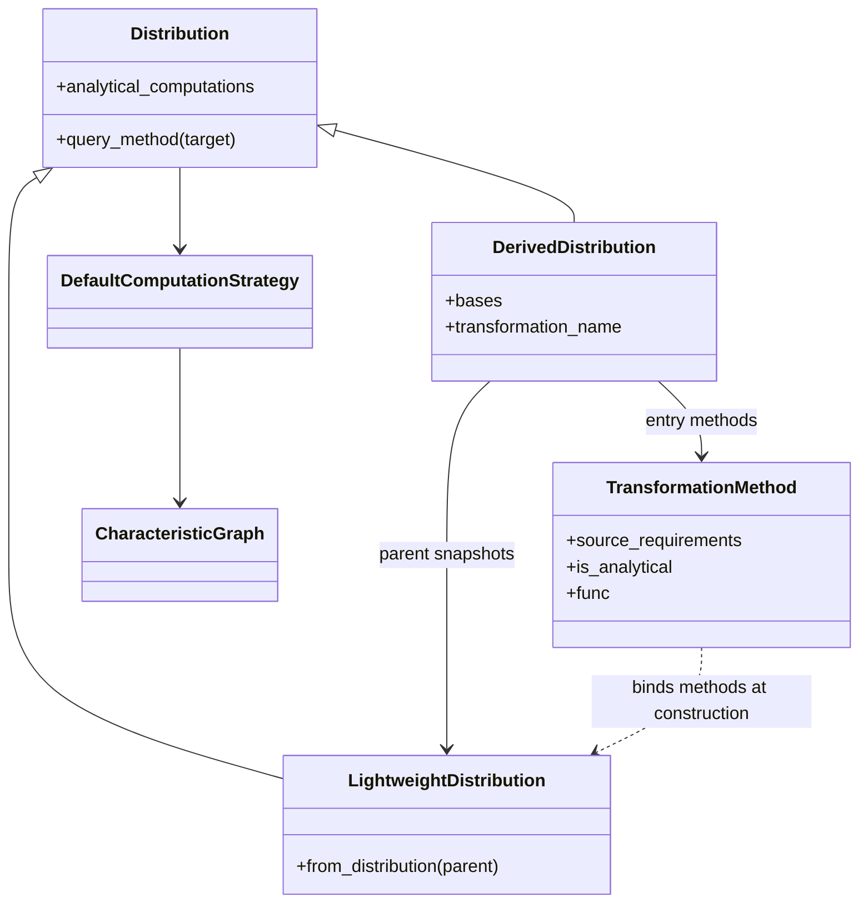
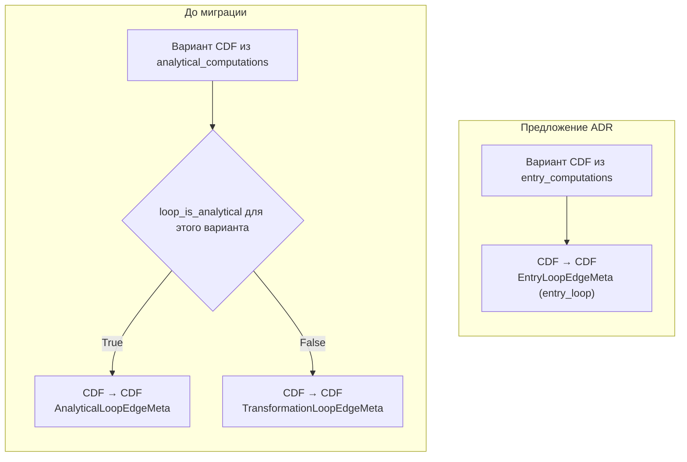
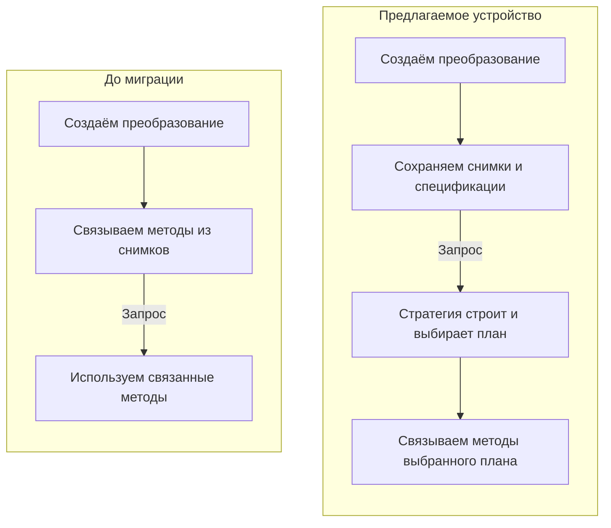
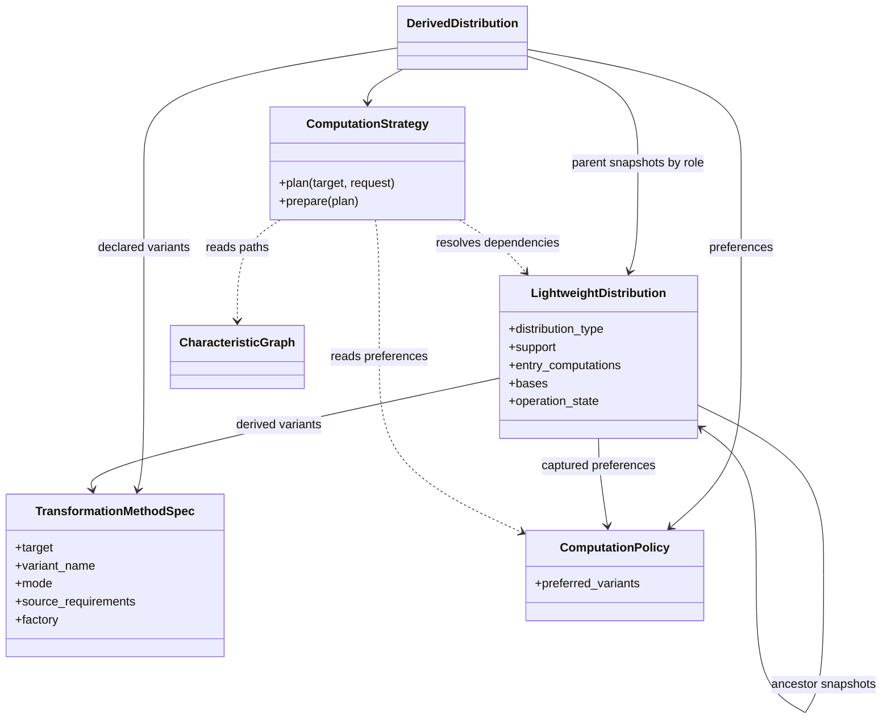
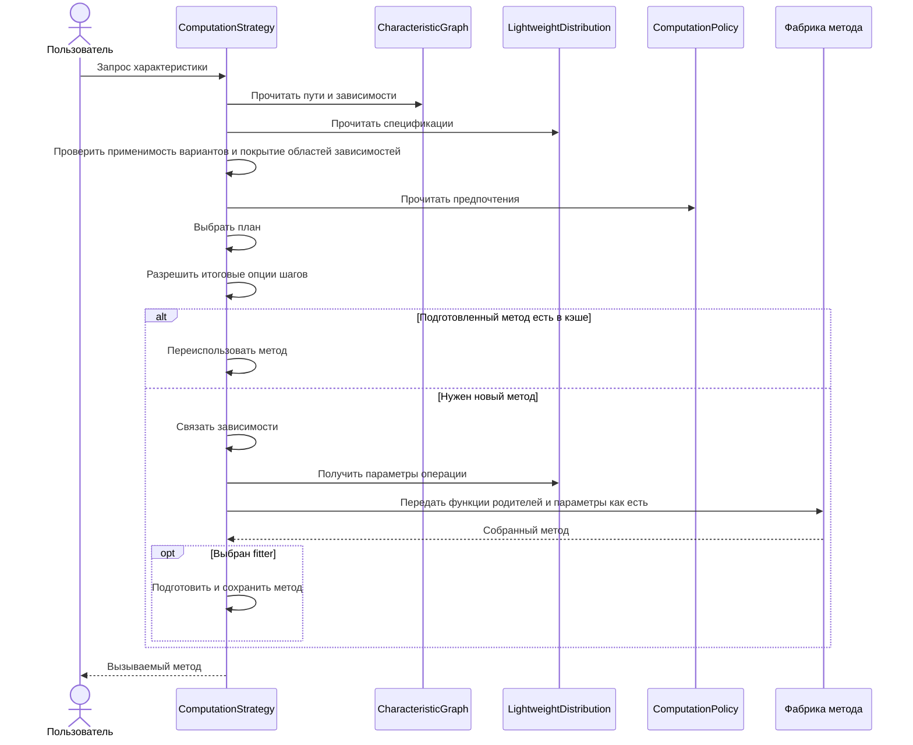

# ADR-0001. Входные вычисления и выбор плана преобразования

## Исходное состояние

До миграции `Distribution` хранит входные методы в `analytical_computations` по характеристике и имени варианта. У каждой входной петли есть признак `is_analytical`.

Стратегия уже разделяет выбор пути и подготовку метода. `explain_computation_path` возвращает план для запрошенной характеристики, а `query_method` использует тот же план, чтобы вернуть входной метод или подготовить конверсии.

`DerivedDistribution` сохраняет снимки родителей (`LightweightDistribution`). При создании объекта `TransformationMethod` разрешает `source_requirements` через снимки и передаёт готовые методы в фабрику вычисления. Например, метод плотности суммы уже связан с конкретными PDF родителей к моменту запроса результата.

**Устройство преобразований до миграции.**



## Предлагаемая архитектура

Предлагается расширить задачу от миграции входных методов до выбора методов родителей при запросе к преобразованию. Выбранные родительские пути станут частью плана запроса.

### Входные методы

Переименовываем `analytical_computations` в `entry_computations` — публичную мапу собственных входных методов распределения. Оба уровня доступны только для чтения: состав фиксируется при создании, чтобы мапа, граф и кэш оставались согласованными. Пустая мапа или пустой набор вариантов для отдельной характеристики отклоняются. Вызов `entry_computations[target][variant_name]` использует вариант вычисления характеристики (`target`) с указанным названием (`variant_name`).

До миграции граф создаёт отдельную петлю для каждого именованного варианта из `analytical_computations`, если его характеристика входит в представление графа. Тип метаданных петли определяется через `loop_is_analytical`. Предлагаем объединить `AnalyticalLoopEdgeMeta` и `TransformationLoopEdgeMeta` в `EntryLoopEdgeMeta` и обозначать все входные петли как `entry_loop`.

**Входная петля до и после миграции.**



Два варианта CDF дают две петли `CDF → CDF`, а `CDF → PDF` остаётся отдельной конверсией. Объединение сохраняет выбор пути: стратегия использует доступность и порядок вариантов, ссылки на методы и рёбра конверсий. Для конверсий граф также хранит ограничения применимости и `options_descriptor`.

Убираем `is_analytical` из метаданных, его расчёт в преобразованиях и копирование в снимки, запрос `loop_is_analytical` и фильтр графа `analytical_variants`. Флаг мог быть `True` у PDF суммы, вычисляемой квадратурой. Имя `analytical_computations` удаляем из конструкторов и свойств без алиаса, а имя класса `AnalyticalComputation` сохраняем. В руководстве по миграции показываем, как перечислить варианты через `variants(characteristic, characteristic)` и распознать `entry_loop` в объяснении пути.

### Снимки родителей и отложенное связывание

Сохраняем `LightweightDistribution`, чтобы вычисление и сэмплирование работали после освобождения исходных родителей. Базовому родителю достаточно существующих данных снимка. Для производного родителя к снимкам предков по ролям добавляем спецификации вариантов (имя, целевая характеристика, режим исполнения и `source_requirements` по ролям) и фабрики методов. Параметры операции и политику, если она задана, фиксируем при создании снимка.

При создании проверяем роли и достижимость обязательных характеристик, включая пути через конверсии. Конкретные методы родителей стратегия выбирает при запросе. При вызове входного варианта по имени адаптер передаёт ей указанную спецификацию. При подготовке выбранного плана стратегия передаёт фабрике выбранные функции и параметры операции из снимка целиком, без изменений. Параметры интерпретирует сама фабрика.

Пользовательская стратегия работает с интерфейсом снимка и спецификациями вариантов. Пользовательская фабрика получает нужные ей данные как явно сохранённые параметры операции. Гарантия работы после освобождения оригинала распространяется на встроенные вычисления и пользовательские расширения, которые работают с этими данными без ссылки на исходный объект. Расширения, которые читают поля исходного объекта, нужно адаптировать к этому контракту.

Спецификация варианта определяет, на какой области понадобится характеристика каждого родителя. При планировании стратегия получает эту область из спецификации с учётом запроса и состояния операции в снимке. Она выбирает один план на зависимость из тех, чья область применимости покрывает требуемую область. Для fitter учитывается область, которую можно подготовить по этому плану. Проверка проходит до связывания методов и вызова фабрики.

**Выбор и связывание методов родителей.**



### Политика и стратегия

`ComputationPolicy` — неизменяемая настройка преобразования. Поле `preferred_variants` хранит порядок имён собственных вариантов для каждой целевой характеристики. Политику можно задать при создании преобразования. Метод `with_computation_policy` возвращает копию с новыми предпочтениями и теми же снимками. При выборе метода родителя стратегия использует политику из его снимка.

`ComputationStrategy` выбирает план по спецификациям: проверяет условия применимости и опции, находит пути к зависимостям по графу и снимкам и применяет порядок из политики к пригодным вариантам. В первой версии на каждую родительскую зависимость выбирается один план. Если ни одно предпочтение не подходит или их нет, сохраняется прежний маршрут, когда он применим. Иначе стратегия пробует evaluator, затем fitter на известной области. Если подходящего плана нет, стратегия сообщает об ошибке.

Когда у характеристики по одному варианту на режим, достаточно имён `fit` и `evaluate`. Если в одном режиме есть несколько вариантов, даём им разные имена, чтобы можно было указать нужный в политике. Режим задаётся в спецификации.

**Границы ответственности.**



### Исполнение, объяснение и кэш

`explain_computation_path` показывает выбранный путь и планы родительских зависимостей до связывания и подготовки. `query_method` использует этот план, связывает зависимости и возвращает вызываемый метод. При обходе зависимостей стратегия проверяет циклы.

В первой версии предусмотрены два режима. В режиме `evaluate` evaluator вычисляет значение при каждом вызове. В режиме `fit` fitter готовит представление, вычисляет по нему и позволяет переиспользовать подготовленный результат из кэша.

Ключ кэша учитывает снимок, вариант, область подготовки, итоговые опции и планы зависимостей. Если fitter требует конечный интервал, стратегия берёт его из запроса или известного конечного носителя. В первой версии вызов за пределами подготовленной области завершается ошибкой.

Материализованный `ApproximatedDistribution` остаётся самостоятельным распределением с готовыми входными методами. Связь аппроксимаций в духе PaCAL с режимами исполнения определим отдельно при проектировании модуля аппроксимаций.

`CharacteristicOption` применяется на шагах, которые объявляют соответствующее свойство характеристики. `ComputationOption` настраивает отдельный шаг. Стратегия разрешает опции по `EdgeOptionsDescriptor` и передаёт шагу итоговые значения.

**Обработка запроса характеристики.**



Выбор `solver` оставляем для будущего расширения опций шага.

## Предлагаемый порядок реализации в #147

Сначала закрепляем контракт `entry_computations` и входной петли, убираем `is_analytical` и обновляем руководство по миграции. Затем расширяем снимки производных родителей, переносим выбор методов в планирование запроса и применяем предпочтения при выборе плана.

## Примеры

В примерах `mixture` — смесь с двумя входными вариантами CDF. Вариант `fit` заранее готовит представление CDF на интервале, а `evaluate` складывает CDF компонентов с весами при каждом вызове. `interval` схематично обозначает область запроса в предлагаемом API.

**CDF смеси без политики.** Если прежний маршрут применим, стратегия использует `evaluate`. В объяснении это один шаг `entry_loop`.

```python
plan = mixture.explain_computation_path("cdf")
cdf = mixture.query_method("cdf")
plan.steps[0].edge_kind  # "entry_loop"
cdf(0.0)
```

**CDF смеси с предпочтением `fit`.** Передаём одинаковый интервал в объяснение и вычисление. Если выбран `fit`, стратегия готовит метод или берёт его из кэша.

```python
configured = mixture.with_computation_policy(
    ComputationPolicy(preferred_variants={"cdf": ("fit", "evaluate")})
)
plan = configured.explain_computation_path("cdf", interval=(-4, 4))
cdf = configured.query_method("cdf", interval=(-4, 4))
cdf(0.0)
```

На `[-4, 4]` оба варианта смеси требуют CDF компонентов на том же интервале. Если `fit` первого компонента покрывает только `[-2, 2]`, стратегия может выбрать у него `evaluate` с достаточным покрытием и сохранить `fit` у смеси. Если у второго компонента есть только PDF, его план может включать конверсию `PDF → CDF`. Вызов `cdf(5.0)` после подготовки на `[-4, 4]` завершится ошибкой. Если конечный интервал нельзя определить при планировании, стратегия пробует `evaluate` у смеси.

**Вызов варианта по имени.** Пользователь сам выбирает `evaluate` у смеси. Стратегия подбирает методы её компонентов.

```python
cdf = mixture.entry_computations["cdf"]["evaluate"]
cdf(0.0)
```

**PDF через конверсию.** У распределения `cdf_only` есть плотность, но из входных методов оно предоставляет только CDF. Стратегия получает PDF, если применима конверсия `CDF → PDF`.

```python
plan = cdf_only.explain_computation_path("pdf")
pdf = cdf_only.query_method("pdf")
pdf(0.0)
```

**Область метода родителя.** Для PDF преобразования `Y = 2X + 10` на `[8, 12]` спецификация требует PDF родителя на `[-1, 1]`. Если у родителя с плотностью есть только входная CDF, стратегия может выбрать применимую конверсию `CDF → PDF`. Фабрика получает выбранную функцию, масштаб и сдвиг из снимка и собирает метод преобразования.

**Опции промежуточных шагов.** Например, на пути `PDF → CDF → PPF` можно отдельно настроить интегрирование и поиск квантиля.

#### Пример будущего расширения опций шага

Конверсия `PPF → CDF` сможет объявить необязательную `ComputationOption` с именем `solver` в своём `EdgeOptionsDescriptor`. Пользователь сможет предпочесть `bisect` через существующий `ComputationPlan.with_options(...)`. Если шаг не поддерживает запрошенный решатель, используется его порядок по умолчанию, начиная с `brentq`. Для такого предпочтения потребуется разрешать его в фактическое значение до обращения к кэшу. Стратегия передаст это значение реализации шага и учтёт его в ключе подготовки.
