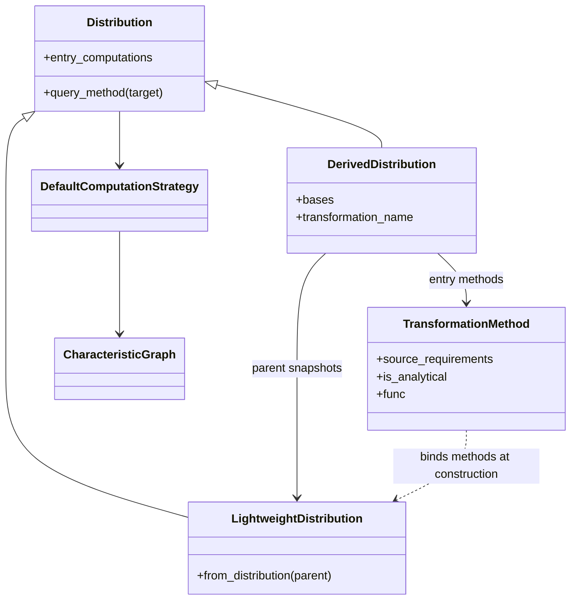
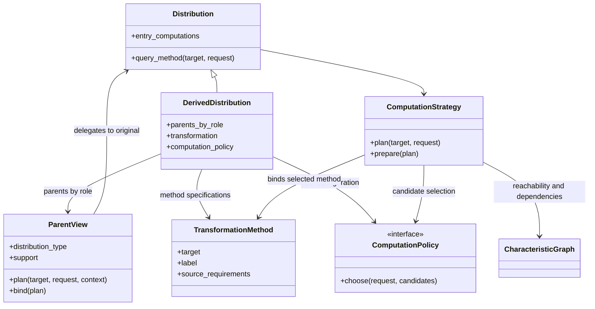
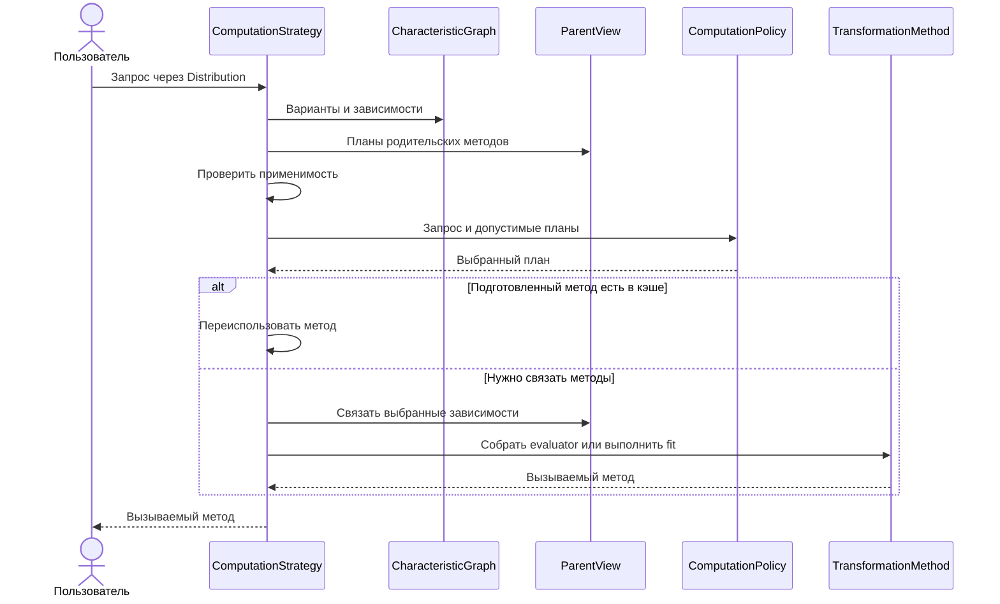

# ADR-0001. Входные вычисления и выбор плана преобразования

Документ относится к задаче #147 эпика #128. Опубликованная задача описывает миграцию API входных вычислений. [Задача #147](https://github.com/PySATL/pysatl-core/issues/147) · [Эпик #128](https://github.com/PySATL/pysatl-core/issues/128).

## Что было и что уже меняет PR #148

В исходном API `analytical_computations` содержала доступные точки начала вычисления. Черновик PR #148 меняет имя на `entry_computations` и открывает карту только для чтения, сохраняя `is_analytical` для методов под отдельными метками. Ветка PR используется как исходная точка для схемы ниже. [PR #148](https://github.com/PySATL/pysatl-core/pull/148).

И в исходном коде, и на ветке PR `DerivedDistribution` сохраняет снимки родителей (`LightweightDistribution`). При создании объекта `TransformationMethod` разрешает `source_requirements` через снимки и передаёт готовые методы в фабрику вычисления. Например, метод плотности суммы уже связан с конкретными PDF родителей к моменту запроса результата. [Устройство преобразований в эпике #128](https://github.com/PySATL/pysatl-core/issues/128).

## Как предлагается решить проблемы

Предлагаем расширить #147 от миграции входных методов до выбора плана преобразования с учётом запроса.

### 1. Единый контракт входных методов

**Проблема.** Флаг `is_analytical` наследует классификацию родительских методов, а сам алгоритм преобразования может быть численным. PDF суммы может получить `True` и при этом считаться квадратурой. При выборе пути стратегия этот флаг не использует.

**Предложение.** `entry_computations` — публичная карта только для чтения на обоих уровнях. Она сопоставляет характеристику с помеченными вызываемыми методами, с которых можно начать вычисление. Состав фиксируется при создании, пустые карты и пустые наборы меток отклоняются. Сам вызываемый объект может иметь собственное состояние.

- Используем `EntryLoopEdgeMeta` и вид `entry_loop` для всех входных вариантов. Граф хранит метки, ссылки на методы и зависимости. Для конверсий он также хранит ограничения применимости и `options_descriptor`.
- Удаляем имя `analytical_computations` из конструкторов и свойств без алиаса, а также `is_analytical`, `loop_is_analytical`, `analytical_variants` и хранение этого статуса в преобразованиях, распределениях и графе. Сохраняем имя адаптера `AnalyticalComputation`. В миграции показываем, как перечислить варианты через `variants(characteristic, characteristic)` и как читать `entry_loop` в объяснении пути.

**Почему поможет.** Карта отвечает на вопрос о доступности метода. Свойства, влияющие на выбор, можно описывать отдельно. Фиксированный состав позволяет согласовать карту, граф и кэш на протяжении жизни объекта.

**Альтернативы.** Изменяемая карта удобна для добавления методов на месте, но требует согласованного обновления графа и кэша. Сохранение флага с узким значением поддержало бы старый фильтр, но не дало бы оценки точности или стоимости. Категории по способу вычисления можно вводить как дополнительные сведения, когда они нужны конкретной политике.

**Пример.** `entry_computations["cdf"]` может содержать `direct` и `spline`. Оба метода представлены как помеченные петли `CDF → CDF`. Переход `CDF → PDF` остаётся отдельной конверсией. Прямой вызов через `entry_computations[target][label]` сохраняет выбранную пользователем метку.

### 2. Исходные родители и связывание при запросе

**Проблема.** Снимки и раннее связывание фиксируют родительские методы до того, как известны область, допуск или политика запроса. Кроме того, требование хотя бы одного прямого родительского входа может исключить вариант, у которого все источники достижимы через конверсии.

**Предложение.** `DerivedDistribution` хранит параметры операции, спецификации методов и сильные ссылки на исходных родителей по неизменяемым ролям `base`, `left`, `right` и `component_i`. Внутренний `ParentView` предоставляет тип и носитель родителя, планирует нужную характеристику через стратегию родителя и связывает выбранный метод. Сэмплирование сохраняет стратегию производного распределения и использует исходных родителей.

- При создании проверяем роли и достижимость. Связывание и подготовку откладываем до запроса. В карте публикуем объявленные варианты, у которых достижимы все обязательные источники, в том числе через конверсии. Применимость к конкретному запросу проверяем позже.
- `source_requirements` перечисляет роли и характеристики. Спецификация может перевести область запроса в координаты родителя и передать допуск, если для операции есть правило переноса ошибки.
- При планировании проверяем все источники многовходовой конверсии, даже если граф отображает их отдельными рёбрами. Цикл определяется на активной ветви. Общий родитель в нескольких завершённых ветвях допустим. Недоступный источник исключает вариант для этого запроса.

**Почему поможет.** Преобразование сможет использовать параметры реального запроса и собственную стратегию родителя. Сильная ссылка сохраняет родителя доступным, пока живёт преобразование, даже если пользователь удалил внешнюю ссылку.

**Альтернативы.** Раннее связывание упрощает вызов готового метода, но фиксирует выбор при создании. Позднее связывание со снимком сохранило бы прежнее время жизни исходного объекта, но стратегия работала бы с копией. Слабая ссылка позволила бы освободить родителя раньше, но поздний запрос мог бы потерять обязательный источник.

**Пример.** Для `Z = 2X + 1` вариант PDF может запросить `PDF(X)`, доступную через `CDF(X)`. Интервал результата `[1, 3]` переводится в `[0, 1]` для родителя. Обычный запрос по-прежнему может использовать прежний путь через `CDF(Z)`. На целевой схеме видно, как `ParentView` связывает стратегию с исходным распределением. Имена дополнительных интерфейсов предварительные.

### 3. Контракт характеристик, методов и качества

**Проблема.** Одной метки метода недостаточно, чтобы понять, в какой области он применим и что означает его ошибка. Например, максимум ошибки CDF на узлах сетки и граница ошибки на всём интервале отвечают на разные вопросы.

**Предложение.** Разделяем математическую характеристику, способ её вычисления и результат подготовки. Для первой версии задаём расширяемый профиль одномерных PDF, CDF и PPF.

| Объект | Минимальный контракт |
| --- | --- |
| Характеристика | Строковый идентификатор, арность, смысл аргумента и результата, допустимые типы распределений, правила границ и существенные опции. Это описание математической величины, общее для всех её реализаций. |
| Вариант вычисления | Целевая характеристика, метка, режим `direct` или `fit`, `source_requirements`, условия применимости и опции метода. Известное покрытие, гарантии и оценки стоимости можно объявить заранее. |
| Подготовленный результат | Вызываемый метод, фактическая область применимости и необязательные сведения о качестве и диагностике. Правило обработки аргументов вне области задаётся в плане. Сегменты, узлы и точки разбиения относятся к представлению, которое их использует. |

У точечной характеристики различаются три области. Носитель описывает возможные значения случайной величины, область аргумента — допустимые входы характеристики, а покрытие метода — интервал, на котором применимо конкретное вычисление или действует его гарантия. Например, `CDF` принимает `x` по всей вещественной прямой, даже если интерполяция подготовлена на конечном интервале. Для первого контракта диапазоны одномерного `x` и вероятности `p` можно описать существующим `Interval1D`. [Типы характеристик и интервалов](https://github.com/PySATL/pysatl-core/blob/cb0bfbca8d3b38e7a6929758f526a3c0d272cf3a/src/pysatl_core/types.py).

| Характеристика | Аргумент и математический результат | Что проверять и в чём выражать ошибку |
| --- | --- | --- |
| `pdf` | Точка `x`. Плотность неотрицательна почти всюду, её полная масса равна единице. | Абсолютная ошибка плотности на заявленной области. Отклонение интеграла от единицы и оценку отброшенной массы учитывать отдельно. Допустимые особенности плотности, включая интегрируемые бесконечности, описывает метод. |
| `cdf` | Точка `x`. `F(x) = P(X ≤ x)`. Результат в `[0, 1]`, функция не убывает, непрерывна справа и стремится к `0` и `1` на соответствующих концах оси. | Абсолютная ошибка в единицах вероятности на заявленной области. Проверять границы, стык с хвостами и монотонность. |
| `ppf` | Вероятность `p`. Для `0 < p < 1` результат — обобщённая квантиль `inf{x : F(x) ≥ p}`. Она не убывает. Поведение при `p = 0` и `p = 1` документируется с учётом возможных бесконечных границ. | Абсолютная ошибка в единицах `x`. Невязка по вероятности может быть отдельной диагностикой. Она не заменяет ошибку в `x`, особенно в хвостах. Формула `F(Q(p)) = p` неприменима как общий критерий для распределений со скачками. |

Для новых одномерных точечных методов массив аргументов даёт массив той же формы. При миграции сохраняется публичное поведение существующих методов при скалярном вызове. Проверки качества `PDF`, `CDF` и `PPF` независимы. Утверждение о согласованности между ними требует общего представления или отдельной проверки с заявленными допусками. `PMF` и скалярные характеристики вроде `mean` продолжают работать по существующему контракту. [Критерии эпика #128](https://github.com/PySATL/pysatl-core/issues/128).

Предлагаемая запись `ErrorEvidence` содержит строковый идентификатор метрики, неотрицательное конечное значение, область оценки, эталон и вид свидетельства (`bound` или `estimate`). Для метрики документируются величина, единицы и способ агрегации. Например, доказанная верхняя граница максимальной абсолютной ошибки CDF на всём интервале и максимум, наблюдавшийся в узлах контрольной сетки, — разные свидетельства. Отсутствие записи означает, что подтверждённая погрешность неизвестна. Число узлов, хвостовой порог и критерий остановки вычисления остаются настройками или диагностикой метода.

Строгое требование к погрешности выполняется только при наличии сопоставимой доказанной границы для результата всего плана. Должны совпадать характеристика, её смысловые опции, метрика и эталон, а область границы должна покрывать запрошенную. Эмпирическая оценка может помочь ранжировать варианты без строгого требования. Перенос гарантии с родителей описывается для конкретной операции. Например, для CDF смеси с неотрицательными весами `w_i` родительские границы `ε_i` на общей области дают вклад не более `Σ w_i ε_i`. Собственную численную ошибку взвешивания нужно учитывать отдельно.

**Решение для #147.** Для встроенного примера `fit` достаточно явной области применимости и, если метод её предоставляет, диагностической оценки погрешности. Если пользователь запросил строгий допуск и ни один план не может его обосновать, стратегия отклоняет запрос.

Новая характеристика получает строковый идентификатор и описание по этому профилю. Можно добавить метод или метрику с самостоятельной семантикой, сохранив существующие имена и поля. Дополнительные типизированные сведения вводятся как необязательные. Неизвестную метрику политика может пропустить при ранжировании, а запрос с обязательной метрикой требует явного отказа при отсутствии подходящего метода. Пользовательские строковые характеристики и текущая регистрация графа продолжают работать без обязательного заполнения новых сведений. [Регистрация характеристик](https://github.com/PySATL/pysatl-core/blob/cb0bfbca8d3b38e7a6929758f526a3c0d272cf3a/src/pysatl_core/distributions/registry/graph.py#L242).

**Почему поможет.** Стратегия сможет проверить покрытие запроса и сравнить свидетельства о качестве в одних единицах. Отдельный контракт для каждой характеристики позволяет добавлять новые методы без изменения математического смысла уже существующих.

**Альтернативы.** Использовать только эмпирические оценки проще, но их недостаточно для строгого допуска. Обязательная граница для каждого метода дала бы единый строгий критерий, но исключила бы существующие реализации без доказанной погрешности. Предлагаемый контракт допускает оба вида сведений и различает их при выборе.

**Пример.** Сплайн CDF на `[-4, 4]` показывает максимальную ошибку `8e-5` на контрольных точках. Для обычного запроса это полезная диагностика. Для запроса «ошибка ≤ `1e-4` во всех точках `[-4, 4]`» нужна доказанная граница на этом интервале. У PPF, в свою очередь, ошибку измеряем по `x`. Малая невязка в вероятности в хвосте может соответствовать заметному сдвигу по `x`.

### 4. Политика выбора при запросе

**Проблема.** Одна характеристика результата может быть доступна разными способами, а универсальный приоритет не учитывает требования пользователя. Выбор всех комбинаций методов родителей может заметно увеличить время планирования.

**Предложение.** Граф описывает варианты, достижимость и зависимости. Стратегия строит пригодные планы, проверяя применимость и строгие требования к качеству. В первой версии родительская стратегия предоставляет один план на запрошенную зависимость. `ComputationPolicy` получает контекст и кандидатов с метками, режимами, зависимостями, качеством и стоимостью. Она возвращает идентификатор одного плана.

Политику храним на `DerivedDistribution`. Функции создания принимают `computation_policy=`, а `with_computation_policy(...)` возвращает копию с новой фиксированной конфигурацией и теми же родителями и спецификациями. Существующие пользовательские стратегии сохраняют вызовы без нового контекста. Для запросов с областью и гарантиями нужны интерфейсы планирования и связывания.

По умолчанию сохраняем прежний маршрут, если он удовлетворяет запросу. Иначе выбираем пригодный прямой план, затем пригодный `fit` с известным конечным интервалом подготовки. При отсутствии пригодного плана сообщаем об ошибке. Пользователь может явно выбрать встроенную политику стоимости или передать свою.

**Почему поможет.** Обычный вызов сохраняет прежний применимый маршрут. Пользователь может настроить конкретное преобразование, а стратегия выполняет только один выбранный план. Делегирование одного плана на зависимость ограничивает перебор и сохраняет самостоятельность стратегий родителей.

**Альтернативы.** Глобальная политика в стратегии уменьшает число настроек на объектах, но сложнее выразить разные приоритеты для разных преобразований. Перебор всех родительских комбинаций может найти лучший общий путь, но потребует бюджета поиска и правил совместного применения политик.

**Пример.** У суммы независимых `X` и `Y` с разными доступными входами можно объявить несколько планов одной PDF. Следующие схемы показывают, почему пригодность и стоимость стоит оценивать для полного плана.

У независимых $X$ и $Y$ доступны соответственно CDF $F_X$ и плотность $f_Y$. Для плотности $Z=X+Y$ есть два пути через конечную разность.

- **Сначала PDF родителя.** Берём конечную разность от $F_X$, затем интегрируем произведение с $f_Y$.
- **Сначала CDF суммы.** Вычисляем $F_Z(z)=\int F_X(z-y)f_Y(y)\,dy$, затем берём конечную разность от $F_Z$.

Поскольку конечная разность $D_h$ линейна, при одной разностной формуле получаем

$$
D_h F_Z(z)=\int (D_h F_X)(z-y)\,f_Y(y)\,dy.
$$

На общих фиксированных узлах квадратуры это одна формула. Адаптивные схемы ведут себя по-разному. В первом случае квадратура должна разрешать резкие изменения численной производной родителя. Во втором независимые ошибки интегрирования могут усиливаться при делении на шаг $h$. При центральной разности ошибка до $\eta$ в каждом из двух значений CDF может дать вклад до $\eta/h$ в ошибку плотности. Число квадратур само по себе не определяет выгодный путь. [Текущие формулы PDF и CDF суммы](https://github.com/PySATL/pysatl-core/blob/cb0bfbca8d3b38e7a6929758f526a3c0d272cf3a/src/pysatl_core/transformations/operations/methods/binary/linear.py#L165) · [Разностная конверсия](https://github.com/PySATL/pysatl-core/blob/cb0bfbca8d3b38e7a6929758f526a3c0d272cf3a/src/pysatl_core/distributions/computations/continuous.py#L146).

Можно сразу вычислить плотность как $f_Z(z)=\int f_Y(z-x)\,dF_X(x)$. Например, при подготовке вычислить массы ячеек $w_i=F_X(b_i)-F_X(a_i)$, а затем переиспользовать их как веса в сумме $\sum_i w_i f_Y(z-x_i)$, где $x_i$ — середина ячейки. Одна подготовка даёт $m$ весов для $m$ ячеек, а запрос из $n$ точек требует $O(nm)$ значений $f_Y$.

Если $f_Y$ липшицева с константой $L$, то при точной CDF вклад ячейки в ошибку ограничен $w_i L(b_i-a_i)/2$. Если отрезок сетки оставляет снаружи массу $\tau$, хвосты добавляют до $\tau\sup f_Y$. Эти оценки объясняют, почему форма плотности и масса хвостов важны для выбора сетки. [Свёртка плотности и меры](https://galton.uchicago.edu/~lalley/Courses/381/Convolutions-Smoothing.pdf).

Плотность суммы иллюстрирует, как сравнивать планы. Первую реализацию контракта проверяем на CDF смеси.

### 5. Оценка стоимости с учётом нагрузки

**Проблема.** Быстрый вызов подготовленного метода может требовать дорогого `fit`. Кроме того, время зависит от выбранных родителей, области и размера пакета.

**Предложение.** Встроенная политика стоимости включается явно. Среди пригодных планов она сравнивает варианты с сопоставимыми профилями по оценке `prepare_ns + число пакетов × evaluate_batch_ns`. При наличии пригодного подготовленного метода учитывает повторное использование. При несопоставимых оценках использует порядок по умолчанию.

Оценка относится к конкретному методу или плану, включая выбранные методы родителей. Время выражаем в наносекундах. `prepare_ns` описывает разовую подготовку, а `evaluate_batch_ns` — один пакет заданного размера в заявленной области аргументов. Оценка учитывает параметры метода. `None` означает неизвестную стоимость, а ноль означает отсутствие работы на соответствующем этапе.

Типовые замеры проводим отдельно от пользовательских запросов. Для конечного интервала бенчмарк сам генерирует представительные точки, в первом приближении равномерную сетку. Если время существенно меняется по области, бенчмарк измеряет центр и хвосты отдельно. Для нескольких размеров пакета отдельно измеряем подготовку и вычисление готовым методом. Результат относится к измеренному методу, параметрам, области, размеру пакета и окружению. Пользователь может указать рабочую область и ожидаемую нагрузку или предоставить профиль из собственных замеров. Передавать точки для типового бенчмарка не требуется.

**Почему поможет.** Политика сможет оценить, окупится ли подготовка на ожидаемой нагрузке, не запуская вычислительные планы для сравнения. Профиль конкретного плана учитывает цену фактически выбранных методов родителей.

**Альтернативы.** Приоритет «всегда сначала direct» прост и полезен как запасное правило, но не замечает окупаемость на повторных вызовах. Пробный прогон всех планов на реальном запросе даст свежие числа, но добавит работу к каждому выбору. В первой версии используем профили, полученные отдельно.

**Пример.** В локальном замере CDF смеси из восьми компонентов прямой метод занимал около 40 мкс за пакет. Сплайн занимал около 300 мкс подготовки и 15 мкс за пакет после неё. Приблизительно после 12 пакетов подготовка начинала окупаться. Для двух компонентов прямой вызов в том же замере был быстрее уже готового сплайна. [Условия замера](#приложение-локальные-замеры).

### 6. Подготовка, объяснение и кэш

**Проблема.** Повторная подготовка увеличивает время, а повторное использование после смены родительского метода может вернуть устаревший результат. Если объяснение запускает `fit`, просмотр плана сам становится вычислительно дорогим.

В локальных проверках исходной реализации обнаружились два сценария для регрессионных тестов. Изменение опции подготовки `CDF` при неизменных настройках `PPF` пересчитывает `CDF`, но оставляет прежний `PPF`. Два разных набора родительских методов для одной дискретной операции с пустыми локальными опциями также могут получить одну и ту же таблицу масс. [Подготовка цепочки](https://github.com/PySATL/pysatl-core/blob/cb0bfbca8d3b38e7a6929758f526a3c0d272cf3a/src/pysatl_core/distributions/strategies.py#L734), [таблица масс](https://github.com/PySATL/pysatl-core/blob/cb0bfbca8d3b38e7a6929758f526a3c0d272cf3a/src/pysatl_core/transformations/operations/distributions/binary/base.py#L246).

**Предложение.** Стратегия планирует, выбирает один вариант и связывает только его зависимости. Прямой метод вычисляет значение на каждом вызове. Вариант `fit` подготавливает представление один раз для совпадающих области, опций и зависимостей, а `evaluate` переиспользует его. Модель опирается на существующие `EvaluatorMethod`, `FitterMethod` и `FittedComputationMethod`. [PR #76](https://github.com/PySATL/pysatl-core/pull/76) · [Текущие вычислительные методы](https://github.com/PySATL/pysatl-core/blob/cb0bfbca8d3b38e7a6929758f526a3c0d272cf3a/src/pysatl_core/distributions/computations/computation.py#L69).

- `query_method` возвращает вызываемый объект. Он и `explain_computation_path` принимают одинаковый необязательный неизменяемый контекст. В первой версии для точечной характеристики можно указать область аргументов и, внутри неё, строгое требование к погрешности с идентификатором метрики и верхним пределом. Для оценки стоимости политика может использовать необязательные сведения о нагрузке.
- Смысловые и алгоритмические опции остаются в существующих `CharacteristicOption`, `ComputationOption` и `EdgeOptionsDescriptor`. Переопределение конкретного шага относится к выбранному плану. Если план изменился и шагу больше нельзя однозначно сопоставить опции, стратегия сообщает об этом.
- Объяснение строит план без запуска `fit`. Для строгого запроса первый вариант контракта выбирает из планов с заранее обоснованной границей. Это позволяет объяснению и вызову ссылаться на один и тот же выбор.
- Кэш плана различает распределение, характеристику, версию конфигурации и поля запроса, влияющие на выбор. Кэш подготовленного метода дополнительно различает конкретный вариант, область подготовки, эффективные опции и сигнатуры зависимостей. Изменение варианта или опций родителя требует повторной подготовки зависимого результата даже при неизменных локальных опциях. Это касается и таблиц масс дискретных операций и смесей. [Текущий кэш стратегии](https://github.com/PySATL/pysatl-core/blob/cb0bfbca8d3b38e7a6929758f526a3c0d272cf3a/src/pysatl_core/distributions/strategies.py#L734).

Для `fit` конечный интервал подготовки берём из запроса или из известного конечного носителя, если он покрывает нужную область. По умолчанию аргумент за пределами покрытия вызывает ошибку для всего пакетного вызова. Политика может явно разрешить прямой путь за пределами покрытия, если план уже проверил его применимость и требования к качеству. Ошибка самой подготовки прерывает выполнение и возвращается с характеристикой, меткой и исходной причиной. Ошибка evaluator сообщается отдельно от отсутствия допустимого плана.

`ApproximatedDistribution` остаётся материализованным результатом с готовыми входными методами и пустыми `bases`. В существующих прототипах PDF обнуляется вне сетки, CDF возвращает `0` и `1` в хвостах, PPF принимает значение ближайшей границы. Эти правила сохраняют совместимость материализованных объектов и сами по себе не расширяют область гарантии. Подготовленный метод в кэше стратегии переиспользуется в рамках исходного плана. [Прототипы PDF, CDF и PPF](https://github.com/PySATL/pysatl-core/tree/cb0bfbca8d3b38e7a6929758f526a3c0d272cf3a/src/pysatl_core/transformations/approximations/linear_interpolations).

**Почему поможет.** Кэш плана отвечает за повторение выбора, кэш подготовки — за повторное использование сплайна или таблицы. Сигнатуры зависимостей отделяют результаты, подготовленные по разным родительским методам. Объяснение использует те же правила выбора без запуска подготовки.

**Альтернативы.** Вычислять всё заново проще, но это теряет выигрыш от подготовки. Кэш только по локальным опциям дешевле проверять, но он может переиспользовать результат после изменения родителя. Повторный выбор после ошибки `fit` мог бы повысить устойчивость, но потребовал бы отдельно объяснять смену плана и её стоимость.

**Пример.** Запрос CDF смеси выбирает сплайн на `[-4, 4]`. Первый вызов `query_method` запускает подготовку, повторный запрос с теми же зависимостями получает готовый метод из кэша. При смене родительской CDF сплайн готовится заново. Если пакет содержит `5`, стандартный вызов сообщает о выходе за область. Явная политика может разрешить пригодный прямой метод за её пределами.

## Предлагаемый порядок реализации в #147

1. **Закрепить контракт входных методов.** Перейти на `entry_computations`, унифицировать входные петли и убрать классификацию по `is_analytical`. Зафиксировать расширяемый профиль PDF, CDF и PPF и обновить руководство по миграции.
2. **Перенести связывание на момент запроса.** Сохранить формулы существующих преобразований, хранить исходных родителей и разрешать обязательные источники через любые применимые конверсии. Проверить совместимость обычных запросов и сэмплирования.
3. **Проверить выбор на CDF смеси.** Прямой вариант считает $F(x)=\sum_i w_i F_i(x)$ для каждого запроса. Вариант с `fit` строит интерполяцию этой же CDF на конечной области. На этом примере проверяем подключение политики, область применимости, объяснение плана и кэш. Для встроенного `fit` достаточно явного покрытия и, если доступна, диагностики. Строгий запрос отклоняется, когда ни у одного плана нет подходящей доказанной границы. [Прямая CDF смеси](https://github.com/PySATL/pysatl-core/blob/cb0bfbca8d3b38e7a6929758f526a3c0d272cf3a/src/pysatl_core/transformations/operations/methods/mixture.py#L213) · [Текущий интерполятор](https://github.com/PySATL/pysatl-core/blob/cb0bfbca8d3b38e7a6929758f526a3c0d272cf3a/src/pysatl_core/transformations/approximations/linear_interpolations/cdf.py#L70).

### Проверки и миграция

- Тесты должны проверять пустые карты и наборы меток, несколько вариантов одной характеристики, построение и выбор входных петель, базовые и аппроксимированные распределения, а также аффинное и бинарные преобразования и смесь. Проверки `is_analytical` заменяются проверками фактически выбранного метода и плана.
- Для преобразований проверить, что создание объекта и объяснение плана обходятся без связывания и `fit`. Покрыть случай, когда все обязательные зависимости доступны только через конверсии, а также исключение плана с недоступной или циклической зависимостью. Проверить, что новый вариант доступен в карте по метке и через пользовательскую политику, а обычный запрос сохраняет прежний применимый путь.
- Проверить, что преобразование удерживает исходного родителя и выполняет запрос после удаления внешней ссылки на него. Проверить сохранение родительских ссылок при клонировании и совместимость генерации выборок.
- Проверить установку политики через функцию создания преобразования и через копию результата оператора. Копия выбирает план по новой политике.
- Для `fit` проверить повторное использование результата при включённом кэше и совпадающем ключе, а также новую подготовку при смене области, значимых опций или метода родителя. Проверить ошибку пакетного запроса за пределами покрытия, явно разрешённый переход к подходящему прямому методу и отказ при строгом допуске, для которого есть только измерение на сетке.
- Проверить, что ошибка подготовки выбранного `fit` возвращается вызывающему коду с меткой метода и исходной причиной.
- Проверить профиль `PDF`, `CDF` и `PPF` на распределении с известным ответом, а также стыки с хвостами и бесконечные границы там, где метод их поддерживает. Проверить, что новый пользовательский идентификатор и дополнительная метрика не требуют менять реализацию графа или существующих методов.

## Вопросы для обсуждения

- **Объём #147.** Предлагаем связать миграцию входных методов и выбор плана. [Этапы и проверки](#предлагаемый-порядок-реализации-в-147).
- **Семантика карты и флага.** Предлагаем публичное чтение карты, несколько меток и отдельные свойства вместо `is_analytical`. [Контракт входных методов](#1-единый-контракт-входных-методов).
- **Вложенные политики.** Для первой версии предлагаем политику на преобразовании и один план от родителя на зависимость. [Выбор при запросе](#4-политика-выбора-при-запросе).
- **Обновление состояния.** Предлагаем менять политику через копию. Изменяемой конфигурации понадобятся версия или явный сброс кэша. [Ключи кэша](#6-подготовка-объяснение-и-кэш).
- **Качество, известное только после `fit`.** Предлагаем проверять строгие требования до подготовки. Для повторного выбора после подготовки потребуется определить, когда можно сменить план и как это отразить в объяснении. [Контракт качества](#3-контракт-характеристик-методов-и-качества).

## Приложение. Локальные замеры

### CDF смеси

В локальном замере сравнили прямую CDF и текущий сплайн на 513 узлах для смесей сдвинутых логистических распределений. Для пакетов из 128 точек у двух компонентов прямой вызов занял около 12 мкс, а вызов уже подготовленного сплайна — около 14 мкс. У восьми компонентов времена составили около 40 и 15 мкс, подготовка заняла около 300 мкс. В этом случае она окупалась примерно после 12 пакетов. Это замер прототипа на одной машине. В стоимость подготовки вошёл поиск границ, а в стоимость вызовов — только вычисление уже полученных методов. Порог зависит от метода, распределения, пакета и окружения.

### Плотность суммы

В локальном замере для суммы двух независимых стандартных нормальных распределений использовали 41 точку на интервале от −4 до 4. Сетка масс содержала 2048 ячеек.

| План | Подготовка сетки | Время на пакет | Максимальная абсолютная ошибка на проверенных точках |
| --- | ---: | ---: | ---: |
| Сначала PDF родителя | — | 99 мс | $1{,}4 \times 10^{-12}$ |
| Сначала CDF суммы | — | 45 мс | $2{,}2 \times 10^{-11}$ |
| Сетка масс, прототип | 0,03 мс | 0,46 мс | $3{,}6 \times 10^{-7}$ |

Первый путь измеряли со скалярным адаптером в прототипе. Текущая квадратура с NumPy 2.5.4 не принимает одноэлементный массив из конверсии `CDF → PDF`. Схемы сравнивались на одной машине с разной наблюдавшейся ошибкой. Эти числа описывают конкретные реализации и не задают порядок выбора для общего случая.
